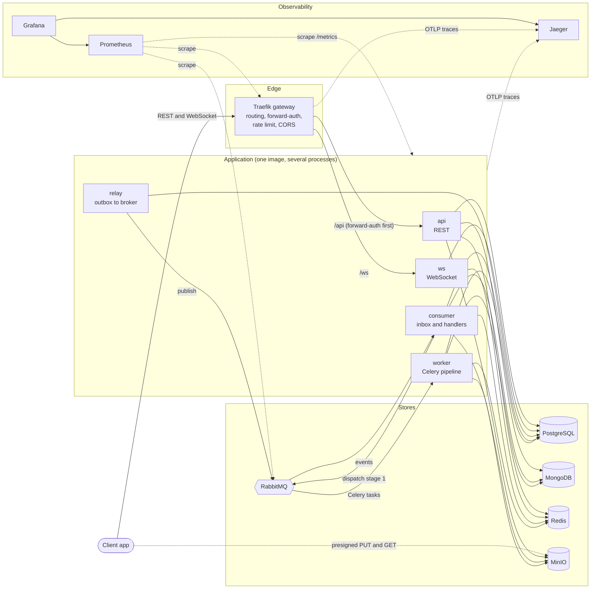
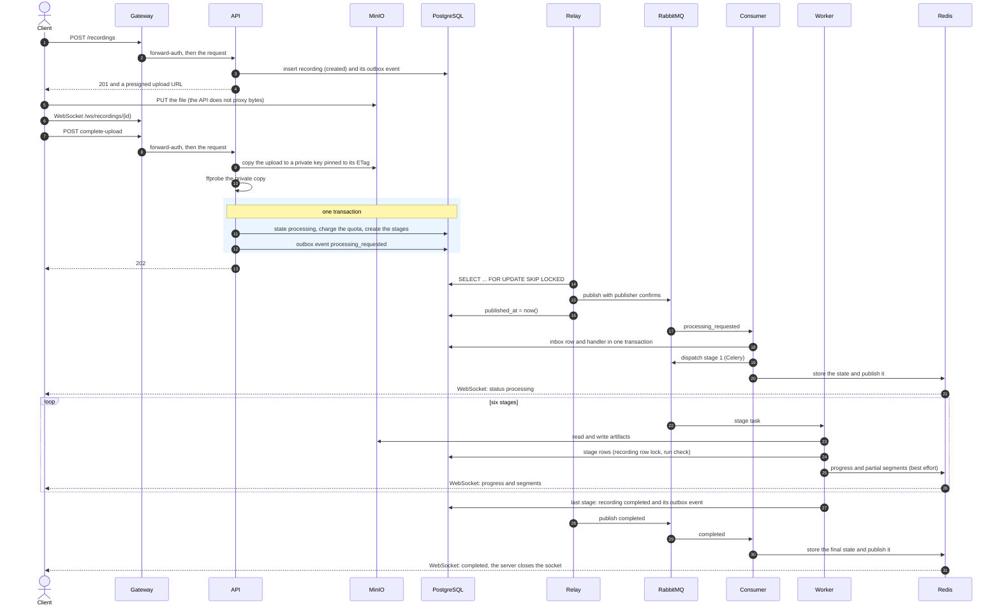
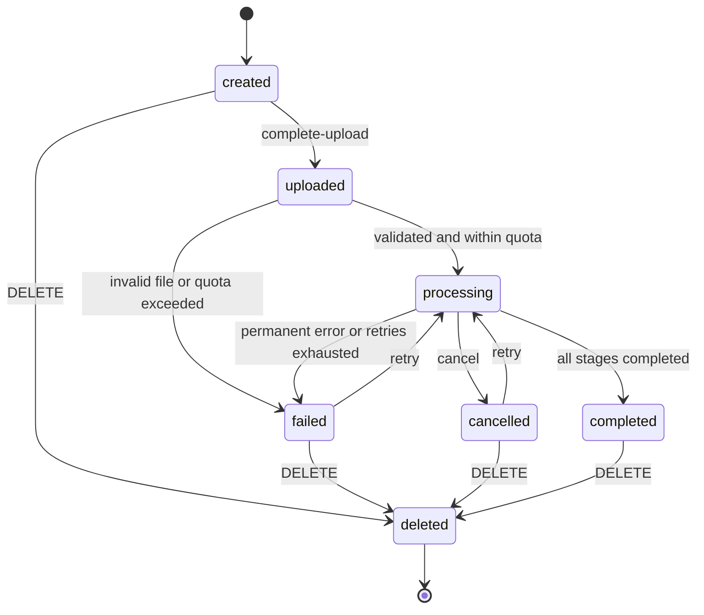
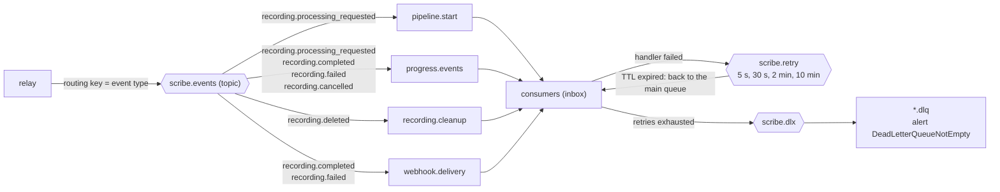
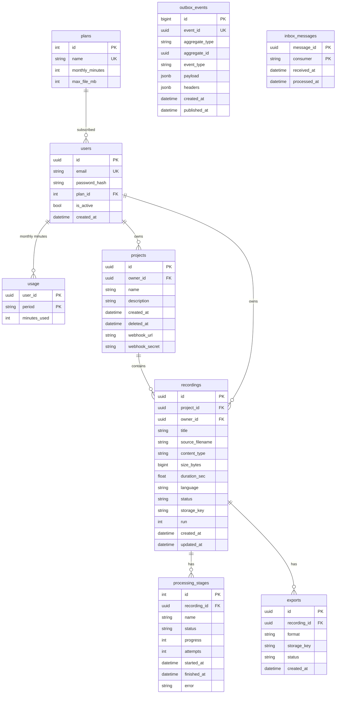

# Architecture

The diagrams are checked against the code by `tests/unit/test_docs.py`: the entity-relationship
diagram must match the database schema, the state diagram the state machine and the message
topology diagram the declared queues.

## Containers

One image runs as five processes; `api` and `ws` are the same code with different routes
(`APP_ROLE`). Only Traefik is reachable from outside, except the presigned URLs that point
straight at MinIO.

## From upload to a finished transcript

The state change and the event that announces it are written in one transaction (Transactional
Outbox). The consumer registers the message id and runs the handler in one transaction (Inbox), so
a redelivered message has no second effect.

## Recording states

Each start of processing increments the recording's `run`. Every pipeline task carries its `run`
and changes state only while it is the current one, under the recording's row lock, so tasks of a
cancelled or retried run cannot touch the new one.

## Messaging topology

Handlers: `pipeline.start` queues the first Celery stage, `progress.events` feeds the WebSocket
state in Redis, `recording.cleanup` removes files, documents and rows of a deleted recording,
`webhook.delivery` calls the project's webhook.

## Data model

PostgreSQL holds the transactional data; MongoDB the transcript segments (one document each, so a
long recording never reaches the 16 MB document limit), transcript metadata and summaries; Redis
refresh tokens, the last progress state per recording and Pub/Sub channels; MinIO the uploads,
pipeline artifacts and exports.

## Guarantees

- **Events are not lost:** an event is committed together with the state change; the relay marks it
  published only after the broker confirmed it. A crash in between publishes it twice.
- **Effects are not doubled:** a consumer commits its inbox row, the handler's database changes and
  nothing else in one transaction; a duplicate finds the row and is skipped. Calls to external
  systems (webhooks) are at-least-once and carry a stable delivery id.
- **Progress is eventually consistent:** status changes are reliable (outbox); stage progress and
  partial segments go straight to Redis, are best effort and never fail a stage. The stored state
  never moves backwards within a run.
- **Traces are continuous:** the W3C trace context is stored in the outbox row, so one trace covers
  the request, the relay, the broker, the consumer, the Celery dispatch and every stage.